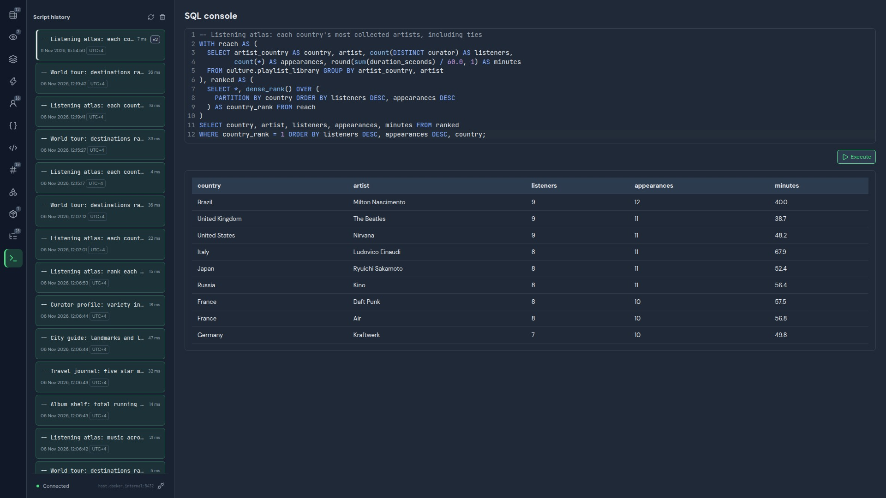
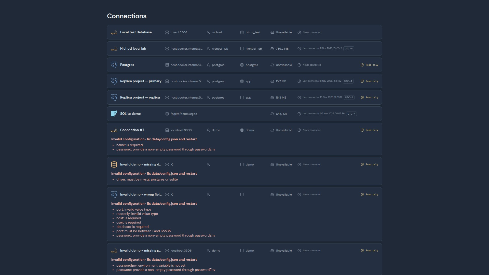
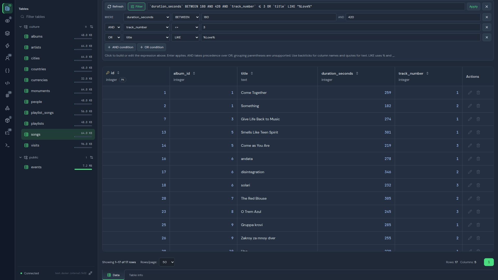
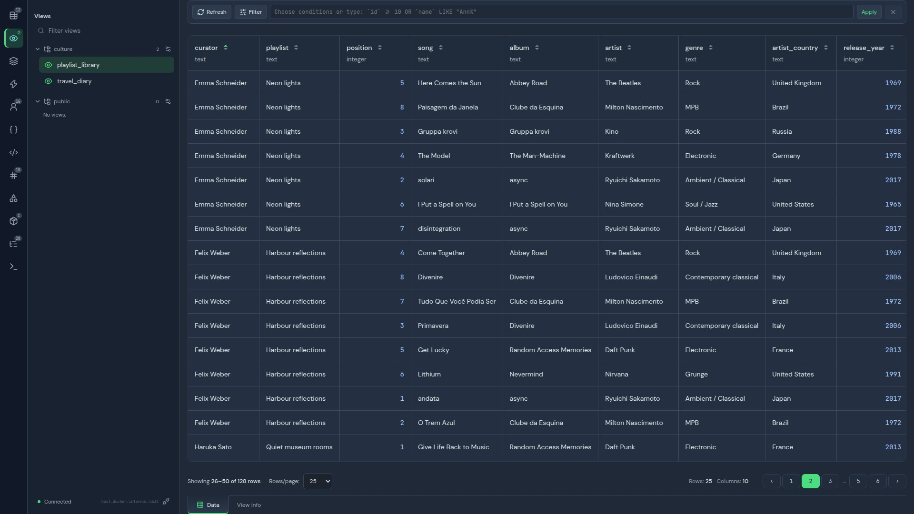
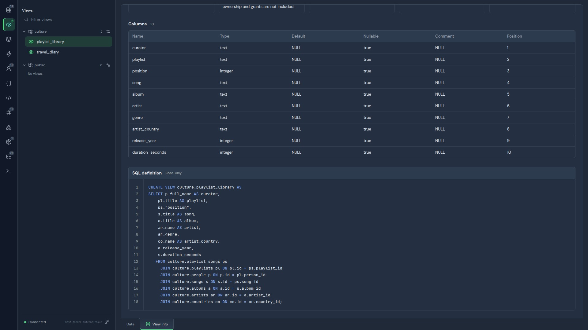
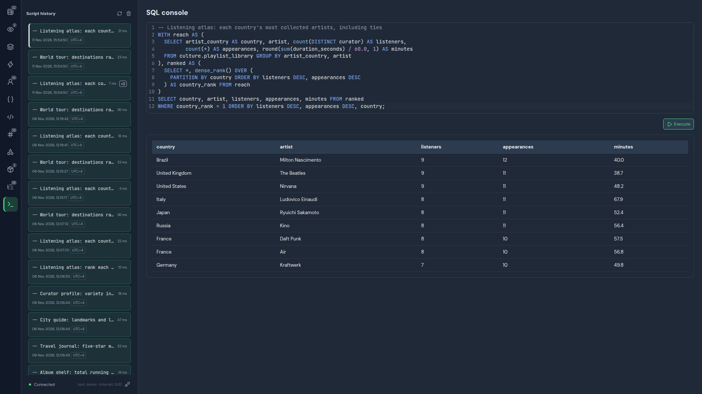

# Nichosi

A database workspace in your browser. Explore tables and views, build precise filters, inspect schema details, and turn SQL into answers — in a dark, IDE-style interface with blue-gray panels and bright green accents.

Nichosi connects to **MySQL, MariaDB, PostgreSQL, and SQLite**. It runs as a self-hosted web app in Docker, with a Go backend and a Svelte + TypeScript frontend. Connections default to read-only; editing requires an explicit writable profile and driver support.



## Explore, query, revisit

- **Browse your database.** Navigate schema-grouped tables and views, search database objects, and inspect column types and keys beside the data.
- **Narrow down the rows.** Combine conditions in a visual filter builder or type an expression. Sort on the server and move through pages without losing your applied filters.
- **Write expressive SQL.** Use joins, CTEs, aggregates, subqueries, and window functions supported by your database. Execute with Ctrl/Cmd+Enter and inspect the result directly below the editor.
- **Keep the useful work.** Per-connection history records SQL source, execution status, timestamps, and duration. Restore an earlier query and run it again explicitly.
- **Understand the structure.** Inspect columns, keys, indexes, foreign keys, triggers, and SQL definitions where the driver exposes them.
- **Review generated edits.** Grid changes go through a ChangeSet SQL preview before transactional application. Views and tables without a usable row key stay read-only.

[Run from Docker Hub](#run-from-docker-hub) · [SQL and history](#sql-scripts-and-history) · [Architecture](docs/architecture.md)

## A closer look

The interface uses **DM Sans** for labels and controls, and **JetBrains Mono** for SQL and code. Both fonts are bundled locally under the SIL Open Font License 1.1; no external font service is required.

All six screenshots in this README show the updated blue-gray theme at **1920 × 1080**, captured against a PostgreSQL demo database. The `culture` dataset connects countries, cities, people, music, playlists, landmarks, and travel diaries through 11 tables and two views. People and activity are fictional; cultural references and numeric values are illustrative. Demo data is not installed automatically when you start Nichosi.

### Start with your connections

The start screen brings your saved database profiles together, with their database engine, connection state, read-only status, cached size, and last successful connection time. Invalid profiles stay visible with actionable configuration errors. Choose a valid profile to enter its workspace. Nichosi runs locally without a separate application login.



### Filters that express more than a search box

Find tracks between three and seven minutes, restrict their album position, or include a title match. The builder and expression field show the same filter; this example returns 17 matching tracks.



Supported operators include comparisons, `BETWEEN`, `LIKE`, `IN`, `IS NULL`, and `IS NOT NULL`. `AND` takes precedence over `OR`; grouping parentheses are currently unsupported. Use the SQL console for queries that need more elaborate logic.

### Real views, real pagination

Browse a seven-table playlist view with readable song titles, artists, albums, and countries. This capture shows **page two: rows 26–50 of 128**, with 25 rows per page and sorting by curator. Page sizes of 25, 50, and 100 are available; applied sorting and filters persist while paging.



### See how a view is built

Switch from data to **View info** to inspect column metadata and a formatted, copyable SQL definition. The playlist view makes its joins visible without leaving the workspace.



### Complex SQL with a result you can read

The opening screenshot ranks artists within each country using two CTEs over the seven-table playlist view, distinct listener counts, and `DENSE_RANK()`. Ties remain visible in the result. The console executes **one SQL statement per run**; a statement can contain multiple CTEs and nested queries. Multi-statement batches are currently rejected.

### A history you can return to

Move from a country ranking to album runtimes, travel journals, or playlist diversity. Each execution creates a history entry with its status, timestamp, and duration. Selecting an entry restores its source without executing it; the example below was restored from history and explicitly run again.



History retains the latest 100 executions per connection. The Docker Compose setup below persists it in the `data/` directory. Results are not stored in history.


## Run from Docker Hub

Use the published [pumphonia/nichosi image](https://hub.docker.com/r/pumphonia/nichosi)
without cloning the repository or installing Go and Node.js. You need Docker with
the Compose plugin and a database reachable from the container. Published images
currently target `linux/amd64`.

Create a directory for Nichosi data in your working directory:

```sh
mkdir -p data
```

Place your configuration at `data/config.json` (copy `config.example.json` from
the repository root for a new setup). The same directory
stores SQL history and cached metadata. On Linux, grant the container user access
before starting (run after placing the configuration file):

```sh
sudo chown -R 65532:65532 data
sudo chmod 700 data
sudo chmod 600 data/config.json
```

Save `compose.yaml` in the working directory, alongside `data/`.
No environment variables or `.env` file are required. The image already listens
on port `8080` and reads `/data/config.json`.

**`config.json`** contains your connection profiles, including database
passwords. If you already have this file, keep your profiles. For a new setup,
adjust this example:

```json
{
  "connections": [
    {
      "name": "My database",
      "driver": "mysql",
      "host": "db.example.com",
      "port": 3306,
      "user": "database_user",
      "database": "database_name",
      "password": "your-database-password",
      "readonly": true
    }
  ]
}
```

MariaDB also uses `"driver": "mysql"`; optionally add `"engine": "mariadb"`.
For PostgreSQL, use `"driver": "postgres"` and the appropriate port (usually `5432`).
Add more profiles to the `connections` array as needed.
Connections default to read-only. Set `"readonly": false` explicitly to request
editing where the driver supports it.

**`compose.yaml`** — comments explain the settings:

```yaml
services:
  nichosi:
    # Download the latest published image from Docker Hub.
    image: pumphonia/nichosi:latest
    restart: unless-stopped
    ports:
      # Nichosi has no application login. Expose it only on localhost.
      - "127.0.0.1:8080:8080"
    volumes:
      # Configuration, SQL history, and metadata in one host directory.
      - ./data:/data
```

Keep `config.json` private and out of version control: it contains database passwords. For a database in another Compose
project, attach Nichosi to that database's Docker network and use its service name
as `host`. Inside the Nichosi container, `localhost` refers to Nichosi itself.
For SQLite, mount your existing database file separately and use its container
path as `database`; see [SQLite files](#sqlite-files) for permissions and profiles.

For a quick test without Compose, use the same `data/` directory:

```sh
docker run -d --name nichosi --pull always \
  -p 127.0.0.1:8080:8080 \
  -v "$PWD/data:/data" \
  pumphonia/nichosi:latest
```

Open [http://127.0.0.1:8080](http://127.0.0.1:8080). View logs with
`docker logs nichosi`; stop and remove the test container with `docker rm -f nichosi`
before switching to Compose. Your data stays in `data/`.

Run these commands from the directory containing `compose.yaml`:

```sh
docker compose pull
docker compose up -d
```

Open [http://127.0.0.1:8080](http://127.0.0.1:8080) and select your connection.
Use `docker compose logs nichosi` to inspect logs and `docker compose restart nichosi`
to reload changes to `config.json`. After changing `compose.yaml`,
run `docker compose up -d` to recreate the container with the new settings.

To update to the latest published image, run `docker compose pull` and
`docker compose up -d` again. Stop the app with
`docker compose down`. The host `data/` directory survives container
removal, including `docker compose down -v`. Back it up together with any SQLite files.

Use **Refresh** above the data grid to reload the current table or view without
reloading the browser page. The selected connection, current page, applied filters,
and sorting are preserved.

## Table information

Use **Table info** at the bottom of the table workspace to inspect storage details,
columns, keys and indexes, foreign keys, triggers, and the read-only `CREATE TABLE`
statement. Metadata loads when you open the tab; reload the browser page to refresh it.
Sizes and row counts are estimates. Unavailable or truncated categories show warnings.
Switch back to **Data** to return to the rows and current page.

## Views

Choose **Views** in the far-left rail and select a view to browse its rows using the
same data grid, page sizes, and pagination as tables. View rows are always read-only,
even on writable connections. The **View info** tab shows properties, column metadata,
and the formatted `CREATE VIEW` statement with a copy control. Reload the browser page to refresh metadata. Views have
no separate table storage; table-only indexes, foreign keys and triggers are not shown.

## Troubleshooting

- **Invalid connections:** Profiles with missing fields, unsupported drivers, incompatible engines, unset password environment variables, or incorrect field types remain in the connection list with configuration errors. Fix `data/config.json` and restart the app to enable them. Unnamed profiles use their position (`Connection #1`, etc.). SQLite does not require a password.
- **No connections appear:** Check that `config.json` contains valid JSON with a `connections` array, then restart the app.
- **The database cannot be reached:** Check the host and port from inside Docker. A database address that works on your computer may not work from a container.
- **Users and roles are unavailable:** MySQL account lists require the optional administrator-installed `nichosi_account_metadata` view. Its absence does not affect other database objects. See [account metadata setup](docs/database-objects.md).
- **The page does not open:** Check that Docker is running and port `8080` is not already in use. View container logs with `docker compose logs nichosi`.

## Project information

- [Architecture](docs/architecture.md)
- [Design guidance](docs/design/README.md)
- [Contributor instructions](AGENTS.md)

Click a column heading in the Data grid to sort all rows on the server. Click again to
reverse the direction. Sorting returns to page one and persists across pagination
and page-size changes; selecting another table or view resets it. MySQL determines
NULL ordering and text collation. Primary keys break ties when available.

Database sizes and last successful connection times are stored in
`data/connection-metadata.json`, alongside SQL history. The metadata file
contains no passwords or DSNs. Configured connections start disconnected and
display their cached observations until the next successful connection.

## SQLite files

SQLite is an embedded database: Nichosi opens an existing file, with no database
server, host, port, user, or password. Paths are absolute paths inside the backend
container. Missing files are rejected. Read-only profiles open the file in SQLite
read-only mode; writable profiles use a transaction for each ChangeSet. Tables
without a usable primary or non-null unique key and all views remain read-only in
the grid. The SQL console can execute scripts on writable profiles.

Add this profile to `config.json`:

```json
{"name":"SQLite database","driver":"sqlite","database":"/sqlite/database.sqlite","readonly":false}
```

To use a file on your computer, create a `sqlite/` directory alongside
`compose.yaml` and place your existing database file there as `database.sqlite`.
Add this mount to the `nichosi` service's `volumes` list in the Compose example:

```yaml
      - ./sqlite:/sqlite
```

The profile above opens `/sqlite/database.sqlite` inside the container. Give UID
65532 access to the directory and file, including write permissions when editing
is needed (SQLite also creates journal files). Run `docker compose up -d` to apply
the mount change. Nichosi never creates a missing database or installs demo data.
Back up the SQLite directory together with `data/`.

## SQL scripts and history

Open SQL console from a connected database's navigation rail. Write SQL, then select **Execute** or press Ctrl/Cmd+Enter. The server
validates and executes the script directly; there is no separate preview step.
Results include row counts and affected rows; execution duration appears in history.

The console always requests transactional execution; there is no mode selector.
SQLite and PostgreSQL support transactional queries and changes. MySQL/MariaDB
currently support read queries only in this mode. Database DDL may have implicit
commit semantics; a single statement does not guarantee rollback support.

History retains the latest 100 executions per connection in `/data/script-history`
and survives container restarts and recreation. History appears in the left sidebar while the SQL console is open.
Select an entry to restore its source, then execute it again
explicitly. **Clear history** removes retained SQL from memory and disk. SQL source and execution
metadata are stored on disk; query results are not retained. Treat the data directory
as sensitive because SQL source may contain confidential values. Unfinished drafts survive workspace navigation
in memory. Generated row edits still require their ChangeSet SQL preview.

The SQL console accepts one SQL statement at a time. Multiple statements show a
warning and disable Execute; the server rejects them before executing anything.

SQL results default to at most 200 rows when the outer query has no LIMIT.
Specify LIMIT in SQL to choose a different count, subject to the safety cap of
1000 rows and 4 MiB per execution. The console has no row-limit control.
